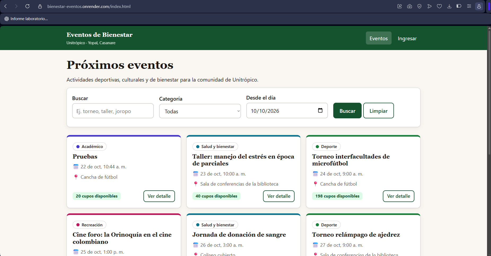
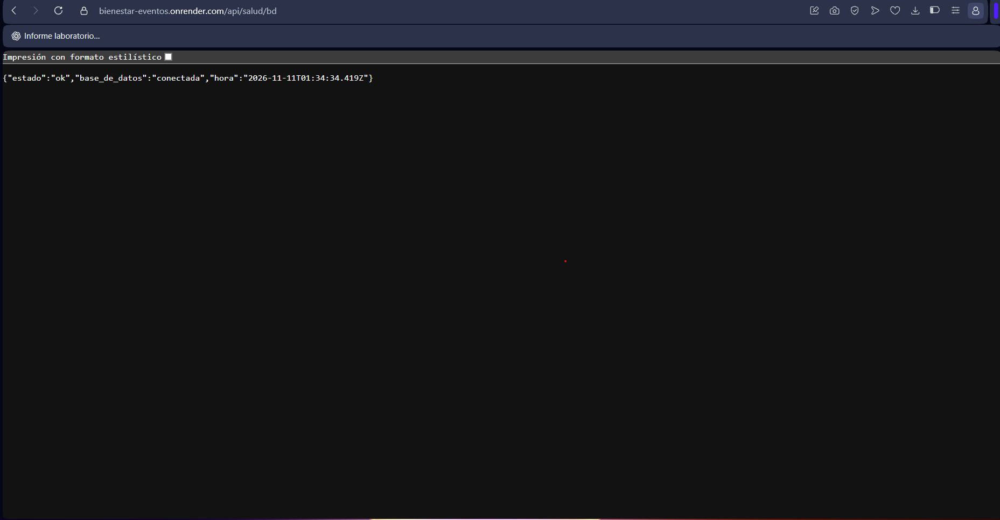
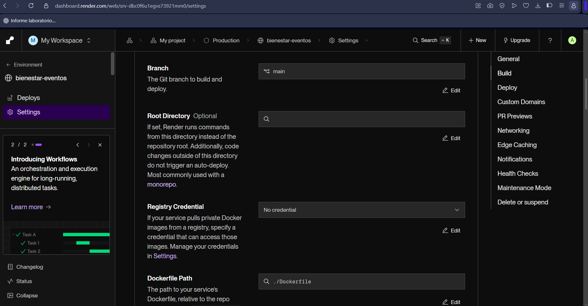
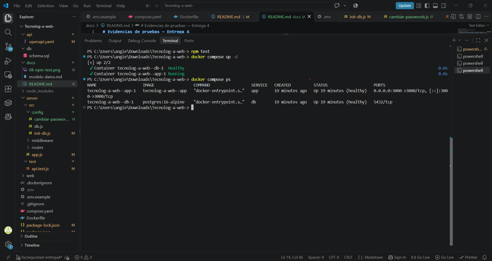
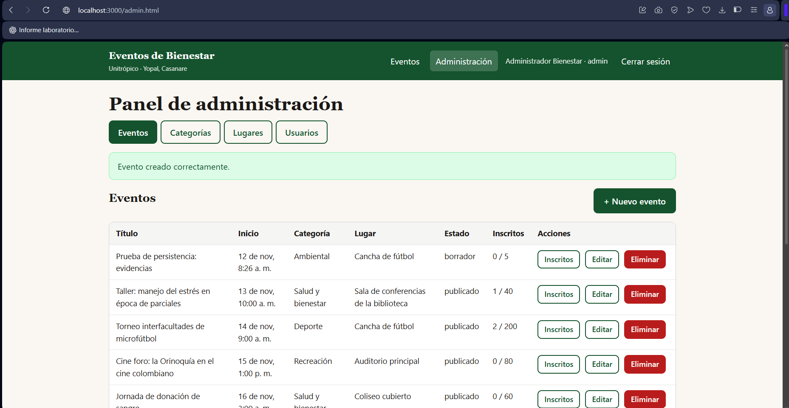
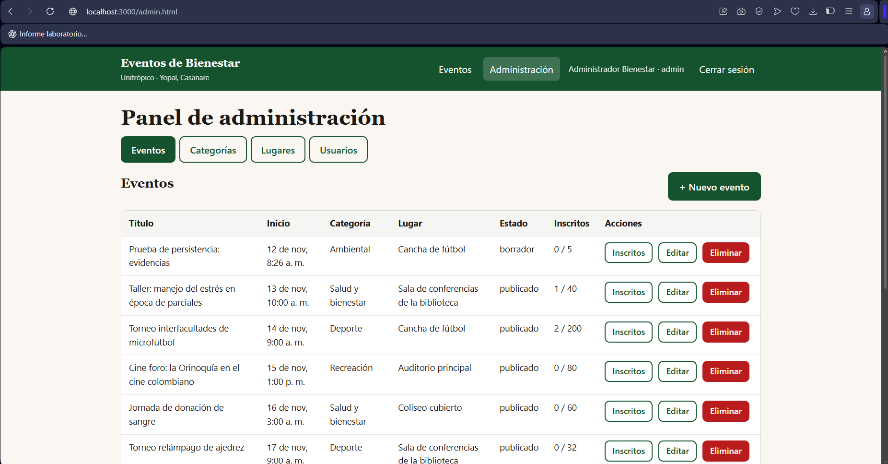
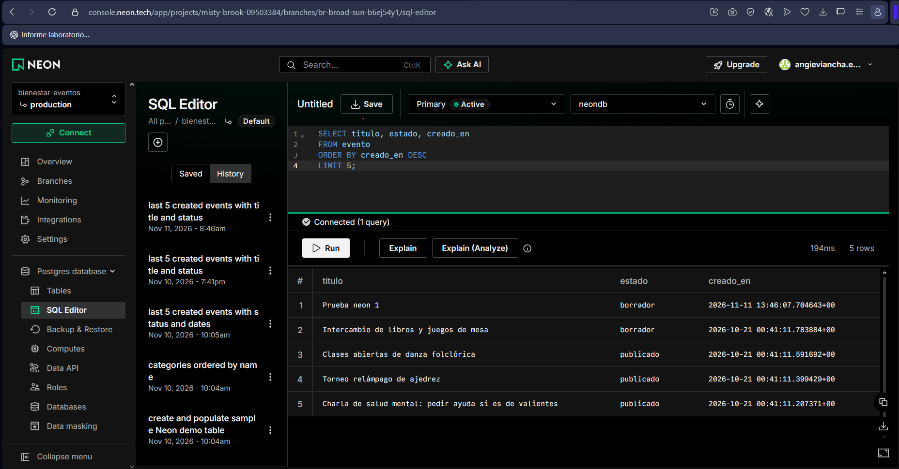
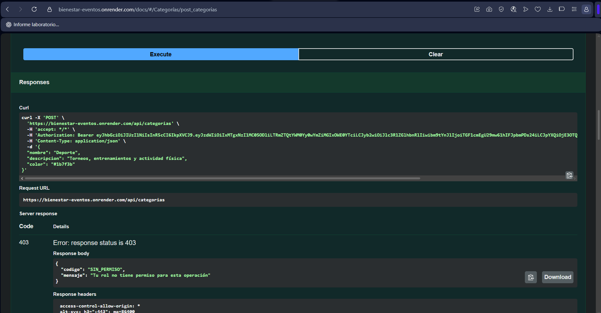
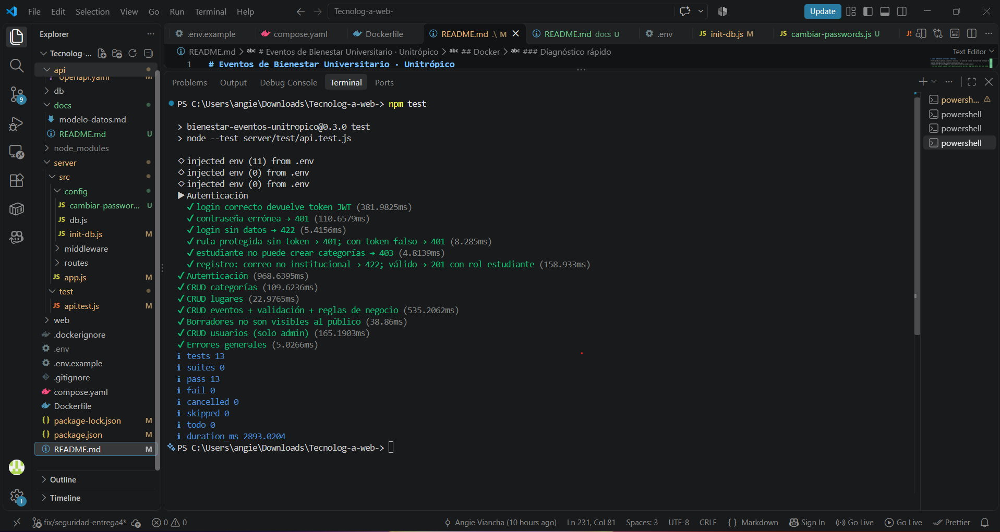
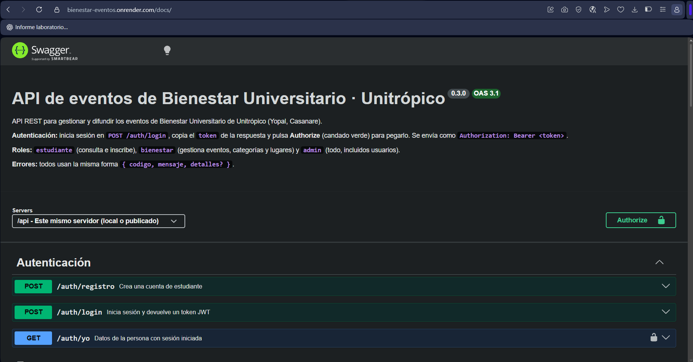

# Evidencias de pruebas — Entrega 4

Guarda en esta carpeta las capturas con estos nombres y pégalas aquí.

| # | Prueba | Archivo | Qué debe verse |
|---|---|---|---|
| 1 | Acceso público | `01-url-publica.png` | La URL de Render abierta y cargando el listado de eventos |
| 2 | API ↔ base de datos (Render) | `02-salud-bd-render.png` | `/api/salud/bd` con `"base_de_datos": "conectada"` |
| 3 | Despliegue con Docker | `03-render-docker.png` | Render → Settings → Build con Runtime Docker, y un despliegue *Live* |
| 4 | Contenedores en ejecución | `04-docker-compose-ps.png` | `docker compose ps` con `app` y `db` en *healthy* |
| 5 | Persistencia | `05-persistencia-antes.png`, `05-persistencia-despues.png` | El mismo dato antes y después de `docker compose down` + `up -d` |
| 6 | Dato guardado en Neon | `06-neon-sql.png` | Consulta `SELECT ... FROM evento` en el SQL Editor de Neon mostrando el dato creado desde la URL pública |
| 7 | Control de acceso | `07-rol-403.png` | Un estudiante intentando una acción de administrador y recibiendo `403` |
| 8 | Pruebas automáticas | `08-npm-test.png` | `npm test` con 13 pruebas aprobadas |
| 9 | Documentación de la API | `09-swagger.png` | `/docs` cargando |

## Persistencia (procedimiento)
1. Iniciar sesión como administrador y crear un dato reconocible.
2. `docker compose down` (sin `-v`) y luego `docker compose up -d`.
3. Comprobar que el dato sigue ahí.

   ## Capturas

### 1. Acceso público
   

### 2. API conectada a la base de datos (Render)
   

### 3. Render ejecutando Docker
   

### 4. Contenedores en ejecución
   

### 5. Persistencia
   
   

### 6. Dato guardado en Neon
   

### 7. Control de acceso (403)
   

### 8. Pruebas automáticas
   

### 9. Documentación de la API
   

Fecha de las pruebas: 11 / 11 / 2026   Responsable: Angie Viancha 