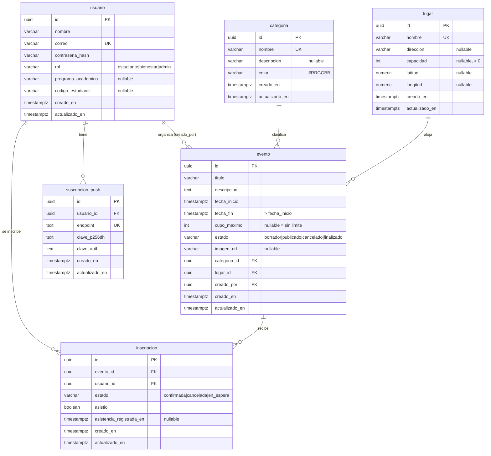

# Modelo de datos

**Motor: PostgreSQL 14+.** Los datos son relacionales (eventos ↔ usuarios ↔ inscripciones), el cupo exige transacciones
(`SELECT … FOR UPDATE`) para que dos personas no tomen el último lugar a la vez, y las restricciones `CHECK`/`FK`/`UNIQUE`
dejan las reglas de integridad en la base de datos y no solo en el código. Nombres en español y en singular.

## Relaciones y comportamiento al borrar

| Relación | Cardinalidad | Al eliminar el padre |
|---|---|---|
| categoria → evento | 1 : N | **RESTRICT** (la API responde 409) |
| lugar → evento | 1 : N | **RESTRICT** (409) |
| usuario → evento (`creado_por`) | 1 : N | SET NULL |
| usuario ↔ evento (vía `inscripcion`) | N : M | CASCADE |
| usuario → suscripcion_push | 1 : N | CASCADE |

## Índices

| Índice | Para qué |
|---|---|
| `evento(fecha_inicio)` | Ordenar el calendario |
| `evento(estado, fecha_inicio)` | Listar solo eventos publicados y próximos |
| `evento(categoria_id)`, `evento(lugar_id)` | Filtros y joins |
| `inscripcion(usuario_id)` | "Mis inscripciones" |
| `inscripcion(evento_id, estado)` | Contar confirmados y lista de espera |
| `inscripcion UNIQUE(evento_id, usuario_id)` | Evita inscripciones duplicadas |
| `usuario(correo)` UNIQUE | Login |

## Reglas de negocio que viven en el modelo
- `fecha_fin > fecha_inicio` (CHECK).
- `cupo_maximo > 0` y `capacidad > 0` (CHECK); el cupo no puede superar la capacidad del lugar (validado en la API).
- `creado_en` / `actualizado_en` en todas las tablas; `actualizado_en` lo mantiene un *trigger*.

> `suscripcion_push` queda creada para la ruta C (PWA y notificaciones); aún no tiene endpoints.
